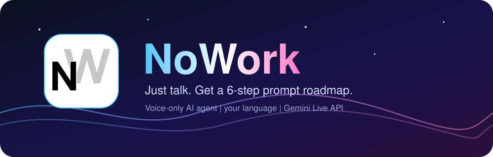
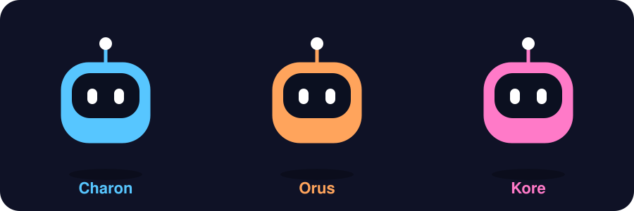
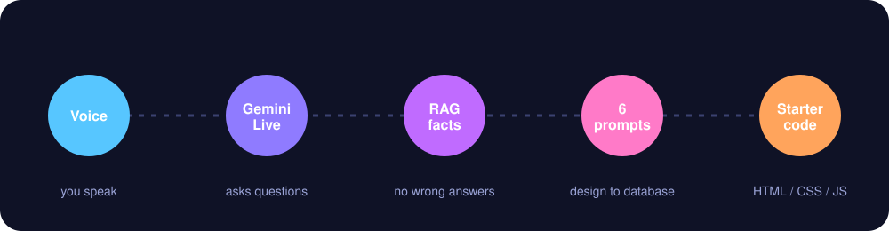
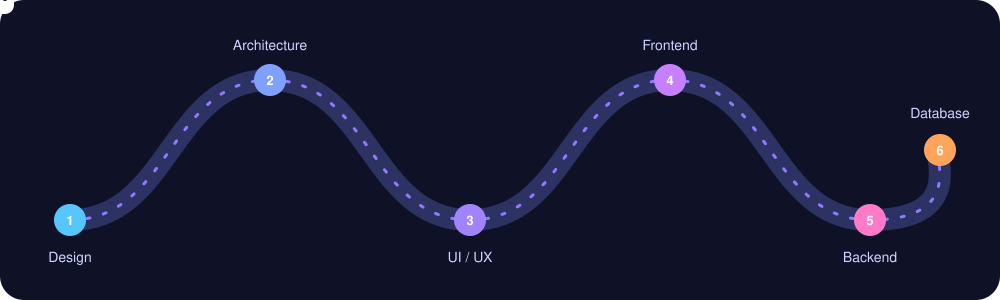

<p align="center">
  
</p>

<p align="center">
  
  
  
  
  
</p>

## What is NoWork?

Most people know **what** they want to build, but not how to ask an AI tool for it. NoWork fixes that with one rule: **no typing, only talking.**

1. You speak, in **your own language**.
2. The agent asks the professional questions a good engineer would ask (which AI tool you use, platform, users, data, limits).
3. When you confirm, it hands you a **roadmap of 6 detailed prompts**: design, architecture, UI/UX, frontend, backend, database.
4. If you want code too, you get a ready **HTML / CSS / JavaScript starter project** with an editor, live preview, live URL and ZIP download.

## Meet the voices

Each voice has its own mascot and its own colour theme. Pick one and the whole site changes colour.

<p align="center">
  
</p>

## How it works

<p align="center">
  
</p>

- **Voice**: the browser streams microphone audio (16 kHz PCM) straight to the Gemini Live API over a WebSocket. The agent answers in audio (24 kHz).
- **Safe keys**: the browser never sees the real API key. The backend mints a short-lived **ephemeral token** at `/api/token`.
- **RAG**: before answering technical questions the agent calls a `lookup_knowledge` tool that searches our own knowledge base (AI tools, stacks, prompt playbook, database design, scope and limits), so it does not invent facts.
- **Roadmap**: the `show_prompts` tool sends the 6 prompts to the page. No chat text is ever shown. It stays a voice product.

## The Prompt page: your roadmap

<p align="center">
  
</p>

The 6 prompts appear as stops on a road. The traveler drives to the next stop, and every stop can be downloaded as a **Word document**. Finished roadmaps are saved to **History** (Supabase, with a local fallback).

## The Code page

| Feature | What you get |
|---|---|
| Editor | Edit every generated file in the browser |
| Live preview | Updates as you type |
| Live URL | Your site served at `/p/<token>/` on a separate origin with a strict CSP |
| ZIP | One click download of the whole project |
| History | Projects are saved (debounced) and reopen after a refresh |

## Tech stack

| Layer | Tools |
|---|---|
| Voice AI | Gemini Live API (WebSocket), function calling |
| Code generation | Gemini flash model with JSON-schema output, validated before use |
| Backend | Python, aiohttp (served on Vercel through an ASGI adapter) |
| Database | Supabase (Postgres, RLS on, server-side service key only) |
| Frontend | Plain JavaScript SPA, hash router, WebGL gradient background, Rive avatar |
| Docs | python-docx for the per-step Word files |
| Safety | Per-IP rate limits, input validation, CSP on live sites |

## Quick start

```bash
cd prompt-maker/backend
python -m venv .venv
.venv\Scripts\activate
pip install -r requirements-dev.txt
copy .env.example .env
python server.py
```

Then open <http://localhost:8000>. Put your `GEMINI_API_KEY` (and Supabase keys for History) in `backend/.env`.

Tests: `pytest` in `prompt-maker/backend`. Full technical notes (folder tree, database setup, Vercel deploy) are in [`prompt-maker/README.md`](prompt-maker/README.md).

## Deploy on Vercel

Set these environment variables in the Vercel project, then deploy:

| Variable | Needed |
|---|---|
| `GEMINI_API_KEY` | yes |
| `SUPABASE_URL` | yes |
| `SUPABASE_SERVICE_ROLE_KEY` | yes |
| `CODE_MODEL` | optional |

After deploying, open `/api/health`. It should return `{"db": true}`.

## Roadmap

- [x] Voice-only agent in any language
- [x] RAG knowledge base
- [x] 6-prompt roadmap with Word downloads
- [x] Code page with live URL and ZIP
- [x] History in Supabase
- [ ] Voice lock (only your voice talks to the agent). Experimental, paused.

## Honest notes

- The key and tokens stay on the server. Never commit `backend/.env`.
- Live URLs are public to anyone who has the link.
- The animated pictures above are hand-made SVGs. The real app avatar is a Rive animation, which GitHub cannot play, so the mascots here are stand-ins.

<p align="center"><sub>Built for the hackathon. Talk more, type less.</sub></p>
